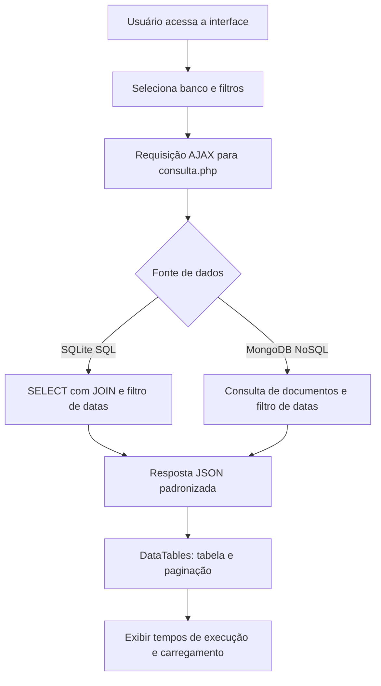
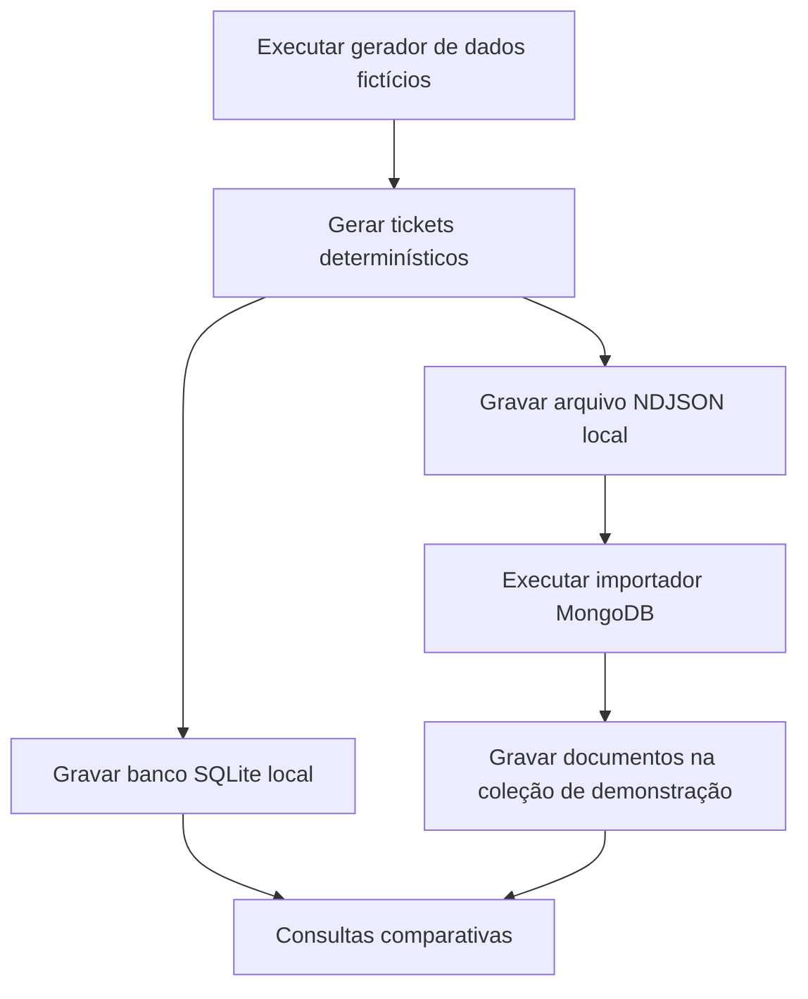

# TicketFlow — PHP, SQLite e MongoDB

> Projeto acadêmico de análise comparativa de consultas em bancos de dados **SQL (SQLite)** e **NoSQL (MongoDB)**, desenvolvido em PHP.


## Visão geral

O TicketFlow foi criado como um exercício de consulta e visualização de tickets em dois modelos de armazenamento. Sua interface permite selecionar **SQLite ou MongoDB**, pesquisar por **intervalo de datas** ou exibir **todos os registros** e acompanhar o tempo de execução da consulta e o tempo total de carregamento da tabela.

Esta versão de portfólio usa somente **dados demonstrativos gerados localmente**. Não inclui bases históricas, dumps, credenciais ou informações de terceiros.

> **Escopo:** é um visualizador para estudo de consultas e não um sistema completo de help desk. Cadastro, atribuição e encerramento de chamados pela interface não fazem parte desta implementação.

## Funcionalidades

- Seleção entre SQLite (SQL) e MongoDB (NoSQL).
- Filtros por data inicial e final, com opção de listar todos os registros.
- Visualização de identificador, título, descrição, data, tipo de serviço, prioridade e status.
- Tabela dinâmica com paginação, ordenação e pesquisa textual.
- Exibição do tempo de consulta no servidor e do tempo total de carregamento no navegador.
- Geração de uma massa **sintética e equivalente** para os dois bancos.
- Importação idempotente dos exemplos no MongoDB, sem publicar os arquivos gerados.

## Fluxograma da consulta



## Fluxograma de preparação dos dados



## Arquitetura

| Componente | Tecnologia | Responsabilidade |
| --- | --- | --- |
| Interface web | HTML, Bootstrap, JavaScript, jQuery e DataTables | Formulário, tabela, filtros e tempo de carregamento |
| Endpoint | PHP | Validação de parâmetros, consulta e resposta JSON |
| Base SQL | SQLite, extensão PHP `sqlite3` | Consultas relacionais com `JOIN` |
| Base NoSQL | MongoDB, extensão PHP `mongodb` | Consulta de documentos |
| Preparação de dados | Scripts PHP | Geração e importação de dados fictícios |

**Dados exibidos:** ID, título, descrição, data de criação, tipo de serviço, prioridade e status do ticket.

O modelo relacional separa **Tickets**, **Data** e **Tipos_de_Servico** em tabelas. O modelo documental armazena os atributos utilizados na consulta em cada documento de ticket.

## Requisitos

- PHP 8.1 ou superior, com extensões `sqlite3` e `mongodb`.
- Servidor MongoDB acessível localmente (ou por URI configurada), para usar o modo NoSQL.
- Navegador com acesso à internet para carregar Bootstrap, jQuery e DataTables por CDN.

Verifique as extensões:

```bash
php -m | grep -Ei 'sqlite3|mongodb'
```

## Executar localmente

Na pasta raiz do repositório:

**1. Gerar a base SQLite e o conjunto de documentos fictícios:**

```bash
php scripts/gerar_dados_demo.php 500
```

Esse comando cria `bd/tickets.db` e `data/demo_tickets.ndjson`, ambos ignorados pelo Git. A cada execução, recria o banco SQLite **local de demonstração** e o arquivo NDJSON. Mantenha backups de qualquer arquivo local que deseje preservar.

**2. Importar para o MongoDB (para habilitar a comparação):**

```bash
php scripts/importar_mongodb.php
```

A conexão padrão usa `mongodb://127.0.0.1:27017`, banco `ticketflow_demo` e coleção `tickets_demo`. Para outro ambiente, configure variáveis de ambiente, por exemplo:

```bash
export TICKETFLOW_MONGODB_URI='mongodb://127.0.0.1:27017'
export TICKETFLOW_MONGODB_DATABASE='ticketflow_demo'
export TICKETFLOW_MONGODB_COLLECTION='tickets_demo'
```

O importador atualiza os IDs existentes e insere IDs novos. Ele **não apaga** documentos antigos da coleção. Para uma comparação rigorosa, use uma coleção vazia ou recrie os dados no mesmo conjunto de IDs.

**3. Iniciar o servidor PHP:**

```bash
php -S 127.0.0.1:8000
```

Acesse <http://127.0.0.1:8000>, selecione a fonte de dados, escolha o período (ou a opção de todos os registros) e clique em **Consultar**.

O modo SQLite funciona sem MongoDB, desde que a extensão `sqlite3` esteja instalada. Para alternar para MongoDB, o servidor e a extensão `mongodb` devem estar operacionais.

## Limites da comparação

A interface mostra **duas medidas distintas**: a duração da consulta processada no PHP e o tempo total até a tabela ser carregada no navegador. Essas métricas **não comprovam por si só** qual tecnologia é mais rápida: tamanho da massa, índices, rede, hardware e formas de modelagem influenciam o resultado. O projeto serve como demonstração educacional, não como benchmark científico conclusivo.

## Organização dos arquivos

```text
TicketFlow/
├── index.php
├── consulta.php
├── consulta.js
├── config.php
├── .env.example
├── .gitignore
├── bd/
│   └── schema.sql
├── scripts/
│   ├── gerar_dados_demo.php
│   └── importar_mongodb.php
└── README.md
```

## Segurança e publicação

- Os dados da demonstração são sintéticos, sem nomes de pessoas ou empresas.
- Não são incluídos banco de dados histórico, grandes exportações JSON, DLL, histórico Git anterior nem scripts `phpinfo()`.
- Variáveis de ambiente são usadas para a URI do MongoDB; credenciais não são armazenadas neste repositório.
- A aplicação destina-se a **uso local e educacional**. Não inclui autenticação, limitação de acesso nem endurecimento para produção.

## Origem do projeto

Projeto acadêmico desenvolvido para estudar diferenças entre consultas em bancos de dados relacionais e não relacionais, posteriormente organizado em uma versão pública de portfólio técnico.
